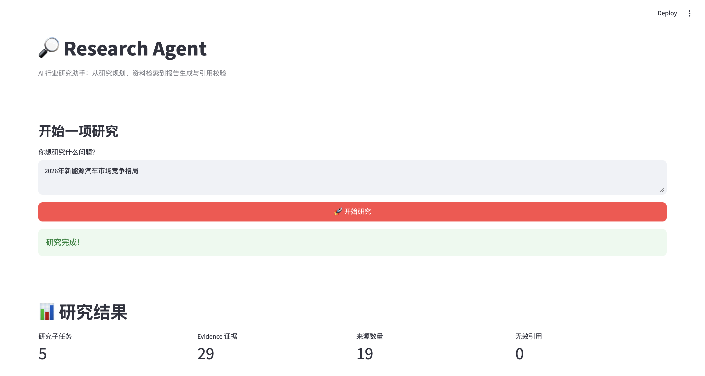
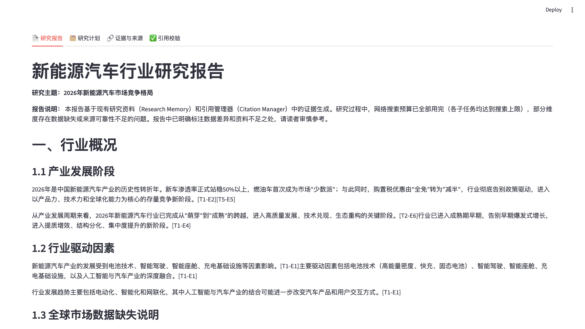
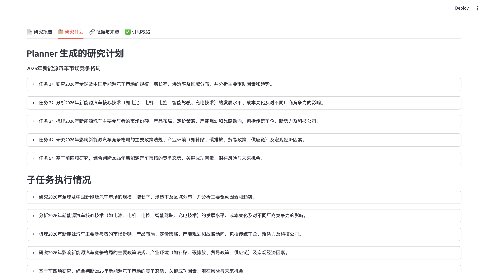
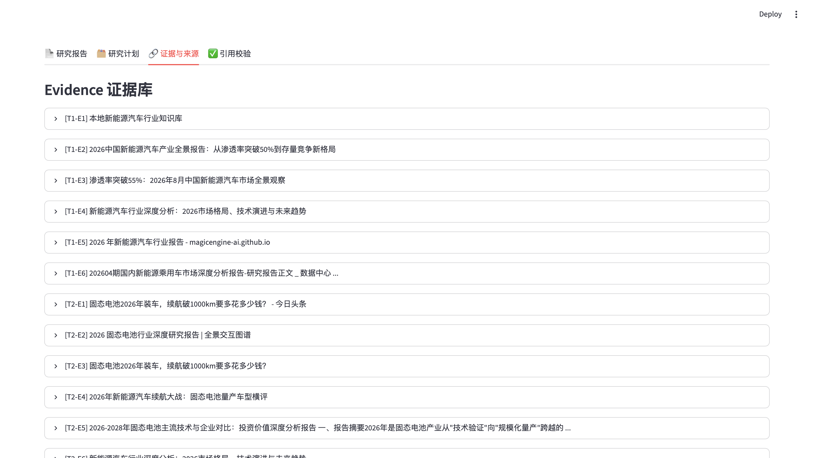
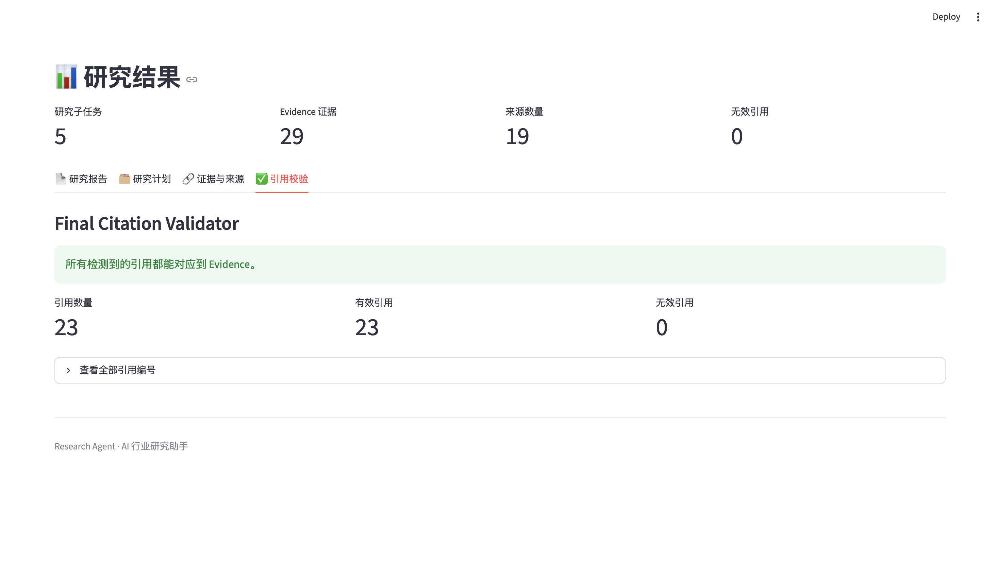
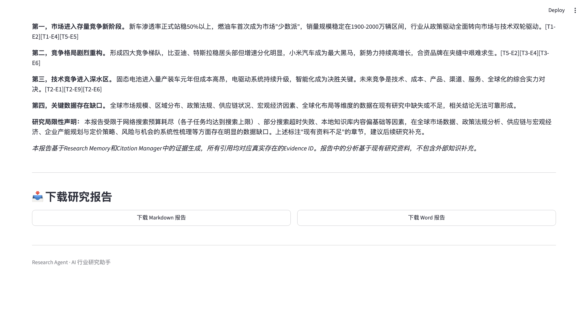

# Research Agent — AI 行业研究助手

一个基于大语言模型的行业研究 Agent 项目。用户输入研究主题后，系统自动拆解研究任务、调用检索工具收集资料、整理研究证据、生成结构化研究报告，并对报告中的引用编号进行校验。

项目使用 Python、LangChain、DeepSeek 和 Streamlit 构建，重点实践 AI Agent 工作流、工具调用、RAG、证据管理与自动化报告生成。

## 一、项目功能

* **Research Planning**：将复杂研究问题拆解为多个可执行的研究子任务。
* **Tool Calling**：根据任务需要调用知识库检索、网络搜索和计算工具。
* **RAG**：基于本地新能源汽车行业资料进行向量检索。
* **Evidence Management**：为研究证据分配编号，保存来源、URL、检索问题和内容，并对重复 URL 进行去重。
* **Research Memory**：汇总多个子任务的研究结果，统一证据编号。
* **JSON Validation & Retry**：解析模型输出，并在 JSON 格式异常时尝试修复。
* **Report Generation**：根据研究结果生成结构化 Markdown 报告。
* **Citation Validation**：检查报告中的引用编号是否能对应到已有 Evidence。
* **Report Export**：支持下载 Markdown 和 Word 格式的研究报告。
* **Web UI**：通过 Streamlit 提供浏览器交互界面。

  
## 项目演示

Research Agent 提供从研究问题输入、研究计划生成、证据收集、引用校验到研究报告生成与导出的完整流程。

### 1. 项目首页与研究流程



### 2. 自动生成研究报告



### 3. 研究计划



### 4. 证据与来源



### 5. 引用来源与校验



### 6. 报告下载与导出




## 二、系统架构

```text
用户输入研究主题
        |
        v
Streamlit Web UI
        |
        v
Research Pipeline
        |
        v
Planner Agent
拆解研究任务
        |
        v
Research Agent
        |
        +----------------------+
        |          |           |
        v          v           v
   Knowledge    Web Search   Calculator
   Search       Tool         Tool
        |          |           |
        +----------+-----------+
                   |
                   v
            Evidence Manager
          证据编号、去重与汇总
                   |
                   v
             Research Memory
                   |
                   v
              Report Writer
                   |
                   v
          Final Citation Validator
                   |
                   v
             Research Report
                   |
                   v
          Markdown / Word Export
```

## 三、技术栈

| 技术            | 用途          |
| ------------- | ----------- |
| Python        | 核心开发语言      |
| DeepSeek API  | 大语言模型调用     |
| LangChain     | 模型调用与相关组件集成 |
| FAISS         | 向量索引与相似度检索  |
| BGE Embedding | 文本向量化       |
| DDGS          | 网络搜索        |
| Streamlit     | Web 交互界面    |
| python-docx   | Word 文档导出   |

## 四、项目目录

```text
research-agent/
├── app.py
├── research_pipeline.py
├── planner.py
├── react_agent.py
├── search_tool.py
├── tools.py
├── rag.py
├── json_validator.py
├── citation_validator.py
├── report_writer.py
├── report_exporter.py
├── llm.py
├── requirements.txt
├── data/
│   └── industry.txt
└── README.md
```

以上为核心文件示例，请以实际项目文件为准。

## 五、运行方式

### 1. 创建虚拟环境

```bash
python3 -m venv venv
source venv/bin/activate
```

### 2. 安装依赖

```bash
pip install -r requirements.txt
pip install sentence-transformers streamlit python-docx ddgs
```

### 3. 配置环境变量

在项目根目录创建 `.env` 文件：

```env
OPENAI_API_KEY=你的DeepSeek_API_Key
OPENAI_BASE_URL=https://api.deepseek.com
MODEL_NAME=deepseek-chat
```

这里的 `OPENAI_API_KEY` 是项目代码使用的环境变量名，实际填入的是 DeepSeek API Key。

**安全提示：不要将 `.env` 文件、API Key 或其他密钥提交到公开代码仓库。**

### 4. 启动项目

```bash
streamlit run app.py
```

启动后根据终端提示打开本地网页地址，输入研究主题即可开始研究。

## 六、研究流程

1. 用户输入研究问题。
2. Planner 将问题拆解成多个研究子任务。
3. Research Agent 根据任务选择合适的工具。
4. 系统检索本地知识库或网络资料，并保存研究证据。
5. Citation Manager 汇总各子任务的 Evidence，统一引用编号。
6. Report Writer 根据研究结果和证据生成报告。
7. Citation Validator 检查报告中的引用编号。
8. 用户在 Web UI 中查看报告，并导出 Markdown 或 Word 文件。

## 七、工程实践

### 结构化输出与异常处理

通过 JSON 解析、格式修复和重试机制，降低模型输出格式异常对工作流的影响。

### 证据追踪

每条 Evidence 具有唯一编号，并尽可能保留标题、来源 URL、检索问题和内容，方便从报告引用回溯研究材料。

### 引用校验

在最终报告生成后检查引用编号是否存在于 Evidence 集合中，识别无法映射的引用。

需要注意：引用编号有效不代表来源内容必然正确，也不代表该来源足以证明对应结论。进一步的事实核验和引用相关性评估仍有改进空间。

### 模块化设计

将任务规划、检索、证据管理、报告生成和导出拆分为独立模块，便于测试、调试和后续维护。

## 八、当前限制

* 网络搜索结果的质量和覆盖面受搜索服务影响。
* 本地知识库的内容范围有限，不能覆盖所有研究主题。
* 部分研究结论可能因来源不足而不够完整。
* JSON 修复和引用编号校验不能保证所有研究事实准确。
* 当前引用校验主要验证编号与 Evidence 的对应关系，并不等于完整的事实核查。

## 九、后续改进方向

* 扩展研究主题与本地知识库。
* 增强来源可信度和引用相关性评估。
* 增加自动化测试与研究质量评估。
* 优化长任务的进度展示和失败恢复机制。
* 完善报告模板及文档排版。

## 十、项目目标

本项目用于实践大语言模型驱动的研究工作流，探索如何将任务规划、工具调用、RAG、证据管理、报告生成和引用校验组合为可运行、可追踪的 AI Agent 应用。
